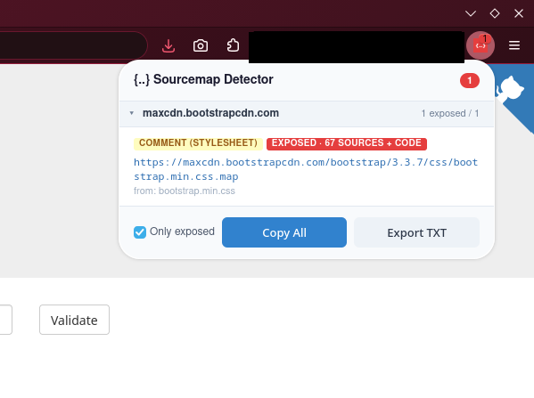

# Sourcemap Detector

A browser extension for Firefox and Chrome that finds JavaScript and CSS sourcemaps exposed by the sites you visit and checks which ones can actually be downloaded.



## Features

- Detects `SourceMap` / `X-SourceMap` response headers on scripts and stylesheets
- Detects `//# sourceMappingURL=` (JS) and `/*# sourceMappingURL= */` (CSS) comments, including in chunks loaded lazily after the page loads
- Detects the same comments in inline `<script>` and `<style>` blocks, including inline data URI maps
- Fetches each referenced map and checks that it is a valid sourcemap
- Groups results by domain, so third-party scripts can be skipped
- Copies all map URLs to the clipboard or exports them to a text file

## Statuses

| Status | Meaning |
| --- | --- |
| Exposed · N sources (+ code) | Valid sourcemap. "+ code" means it includes `sourcesContent`, the original source |
| Embedded | Inline data URI map |
| HTTP *nnn* | Referenced, but the server returns an error |
| Not a sourcemap | The URL responds, but not with a sourcemap (e.g. a soft 404 page) |
| Fetch failed | Network error or timeout |
| Redirects (not followed) | The map URL redirects. Redirects are never followed |
| Not checked (private host) | The map is on localhost or a private network address but the page isn't, so it isn't fetched |
| Too large to check | Over 30 MB |

The toolbar badge is red with the number of exposed maps, or grey with the number of references when none are confirmed.

## Using the popup

- The domain bar at the top lists every domain that references a sourcemap, with its count. Click a domain to skip it, and click it again to include it. Skipped domains are hidden from the list and left out of Copy All and Export on every site.
- Groups for the current site start expanded, other domains start collapsed. Click a group header to toggle it.
- With **Only exposed** ticked (the default), Copy All and Export include only maps confirmed downloadable.
- The count in the header shows how many maps Copy All and Export will include, out of the total found.

Skipped domains and the Only exposed setting are remembered.

## Privacy

To read file contents, the extension downloads each script and stylesheet a second time, plus every sourcemap they reference. These requests are made without cookies. The extension collects no data and sends nothing anywhere other than the sites you visit. Settings are stored locally in your browser.

Public pages can't make the extension request localhost or private network addresses, and it never follows redirects. This check uses hostnames only, so a public DNS name that resolves to a private address is not caught.

Only use it on sites you are authorized to assess.

## Building

Requires Node.js.

```sh
npm run build            # builds dist/firefox and dist/chrome
npm run package:firefox  # dist/sourcemap-detector-firefox.zip (needs zip)
npm run package:chrome   # dist/sourcemap-detector-chrome.zip (needs zip)
npm test
```

## Loading an unpacked build

- **Chrome:** open `chrome://extensions`, enable Developer mode, click **Load unpacked** and select `dist/chrome`.
- **Firefox:** open `about:debugging#/runtime/this-firefox`, click **Load Temporary Add-on** and select `dist/firefox/manifest.json`.

## Project layout

```
src/shared/      detection, sourcemap validation and URL helpers
src/background/  request monitoring, fetching and verification
src/content/     page scanning for inline blocks and loaded resources
src/popup/       popup UI
manifests/       Firefox (MV2) and Chrome (MV3) manifests
test/            unit tests (node --test)
```
